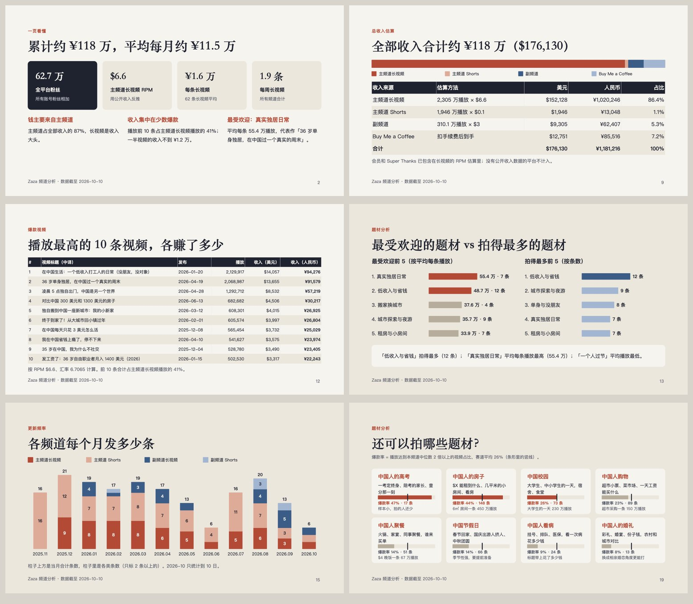
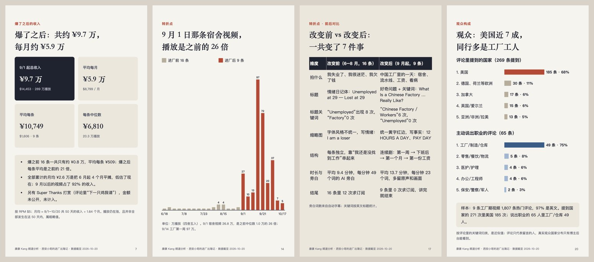

# YouTube Channel Report

一个给 Claude Code 和 Codex 用的 skill：给它一个 YouTube 频道，它抓数据、算收入，最后交给你一份有数据支撑的中文 PPT 分析报告，横版（16:9）和竖版（9:16，竖屏播放）各一份。



竖版（9:16）用同一份内容重新排版，适合竖屏播放和手机上看：



外部估算一个频道的收入，难点不在乘法，而在三件容易做错的事：
- **数据准不准**：要拿到每条视频的精确播放和精确日期，长视频和 Shorts 要分开。
- **RPM 怎么定**：能反推就反推，不能反推要说清楚是假设。
- **口径前后一致**：月均从哪天算起，每条视频怎么平均，会员和打赏算不算。

这个 skill 把这三件事固定成脚本和规则。需要判断的部分交给 AI：RPM 用多少、题材怎么分、标题怎么翻译、结论怎么写。

## 它做什么

- **抓数据**：频道的订阅、总播放、建号日期和外链。每条长视频、每条 Shorts 的**精确播放量**和**发布日期**，不是 “2.1M views”“10 months ago” 这种约数。还会做完整性校验：长视频加 Shorts 的播放应该约等于频道总播放。
- **算收入**：长视频按 RPM 算，Shorts 单独按每千次播放的价格算。公开过收入的频道可以**反推 RPM**。站外打赏（Buy Me a Coffee 等）按分档估算，再扣掉平台费和支付手续费。汇率自动获取。
- **出结论**：累计收入、平均每月、平均每条（同时给中位数），播放最高的 10 条视频各赚多少，最受欢迎的题材和拍得最多的题材，每月发了多少条、最近 90 天快了还是慢了，以及多平台的账号矩阵。
- **拍摄器材和拍摄方式**：扫描简介和评论里的器材线索，下载 YouTube 自动截取的视频帧拼成联系表，读取分辨率和帧率。AI 逐帧统计拍摄方式（手持自拍、固定机位、第一视角……），再结合证据推断器材，每一条都标明是“有证据”还是“推断”。
- **出 PPT**：同一份内容出两份——16:9 横版，和 9:16 竖版（每种页面都重新上下排版、字号放大，适合竖屏和手机）。自带 20 种版式，包括数据页（KPI、表格、柱状图、题材对比）和叙述页（启示、卡片、对比面板、编号建议）。柱状图用形状画，在 PowerPoint、Keynote 和访达预览里都能正常显示。生成完自动用 Keynote 渲染成图片，用来检查排版。
- **附带**：逐条视频的 CSV（含中文标题、题材、收入，用 Excel 打开不乱码），以及一份 `report.md` 摘要。

## 前置条件

- **Python 3**：抓数据和计算只用标准库，不需要装任何包。
- **Node.js** 加 `pptxgenjs`：生成 PPT 时需要，第一次运行 `npm install --prefix ~/.cache/ycr-node pptxgenjs@3.12.0` 即可。
- **macOS + Keynote**（可选）：用来把 PPT 渲染成图片检查，也可以导出 PDF。没有的话，可以改用 LibreOffice。
- **yt-dlp**（可选）：只有需要精确到分钟的发布时间、本机又被 YouTube 判定为机器人时才用到。
- PPT 默认用 Mac 自带的宋体和苹方。要发给 Windows 用户，建议导出成 PDF。

## 安装

```bash
git clone https://github.com/superchaospc/youtube-channel-report.git \
  ~/.claude/skills/youtube-channel-report
```

要让 Codex 也能自动触发，做一个软链接即可，两边用的是同一种 skill 格式：

```bash
ln -s ~/.claude/skills/youtube-channel-report ~/.codex/skills/youtube-channel-report
```

## 使用

直接说就行，skill 会自己触发：

- 「分析一下 youtube.com/@zazainchina，做一份频道分析 PPT。」
- 「这个频道去掉 Shorts 一共赚了多少？RPM 按 5 到 7 美元算，换成人民币，算平均每月和每条。」
- 「他说自己赚了 15 万美金，反推一下 RPM。」
- 「把副频道、TikTok、Instagram 和 Buy Me a Coffee 也算进去。」
- 「按这份提纲做 PPT，把提纲补充完整」（附上提纲文件）。

只想要数字、不要 PPT 时，它会在算完之后直接回答。

## 脚本也可以单独用

```bash
S=~/.claude/skills/youtube-channel-report/scripts

python3 $S/fetch_channel.py @handle --out WORK/data           # 抓一个频道：about.json / long.json / shorts.json
python3 $S/social_stats.py --tiktok handle --bmc slug        # TikTok 粉丝数和 Buy Me a Coffee 支持者人数
python3 $S/gear_scan.py WORK/data/handle --out WORK/gear     # 拍摄器材证据：简介、评论、截帧联系表、分辨率和帧率
python3 $S/compute_report.py WORK/config.json                # 计算，输出 numbers.json、report.md、CSV、deck.json
$S/build_decks.sh WORK/out/deck.json WORK 报告              # 一次生成横版 + 竖版 PPT，各自渲染检查并导出 PDF
NODE_PATH=~/.cache/ycr-node/node_modules \
  node $S/build_deck.js WORK/out/deck.json WORK/报告.pptx    # 只生成 16:9 横版
NODE_PATH=~/.cache/ycr-node/node_modules \
  node $S/build_deck_portrait.js WORK/out/deck.json WORK/报告-竖屏.pptx   # 只生成 9:16 竖版
$S/render_check.sh WORK/报告.pptx WORK/png --pdf             # 用 Keynote 渲染成图片和 PDF，并拼成联系表
```

最小的 `config.json`：

```json
{"title": "XX 频道分析", "channels": [{"data": "data/handle", "label": "主频道", "rpm": 5}]}
```

全部字段见 [references/config.md](references/config.md)，PPT 的页面类型见 [references/deck-json.md](references/deck-json.md)。

## 横版和竖版

两份 PPT 用同一份 `deck.json`，改内容只改这一个文件，再跑一次 `build_decks.sh`，两份一起更新。

- **横版** `报告.pptx`：16:9，适合电脑和投影。
- **竖版** `报告-竖屏.pptx`：9:16（7.5×13.33 英寸），每种页面都改成上下排列：KPI 排成 2×2，左右对比改成上下对比，正文 15–16pt。表格、卡片和柱状图会自动拉高，铺满屏幕。长标题在中文标点处自动断行，不会让最后一行只剩一个字。
- 4 列以上的宽表格在竖屏里太挤。在那一页加 `"portrait": {"columns": [...], "rows": [...]}`，竖版就只保留关键列。`"portrait": false` 可以让某页不进竖版。全部竖版字段见 [references/deck-json.md](references/deck-json.md)。

## 口径

- 长视频和 Shorts 分开算。“去掉 Shorts”指收入和播放都不算 Shorts。
- 月均 = 累计收入 ÷ 月数，月数从主频道第一条长视频算到今天。
- 每条 = 长视频收入 ÷ 长视频条数，同时给出中位数。
- 会员和 Super Thanks 不单独估算，已经摊进了 RPM。
- RPM 的默认取值和反推方法见 [references/rpm-and-income.md](references/rpm-and-income.md)。

## 局限

- 所有收入都是**估算**。真实的 RPM 只有频道主在 YouTube 后台能看到。
- 数据来自 YouTube 的公开接口（innertube）。YouTube 改版时，字段可能会变，`references/data-gotchas.md` 里记录了已知的坑和绕法。
- 题材分类、标题翻译、打赏分档比例都是人工判断或假设，报告里会写明。
- TikTok 和 Instagram 只统计粉丝数，不估算收入。

## License

MIT
